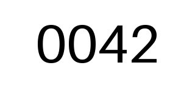
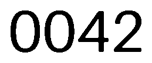
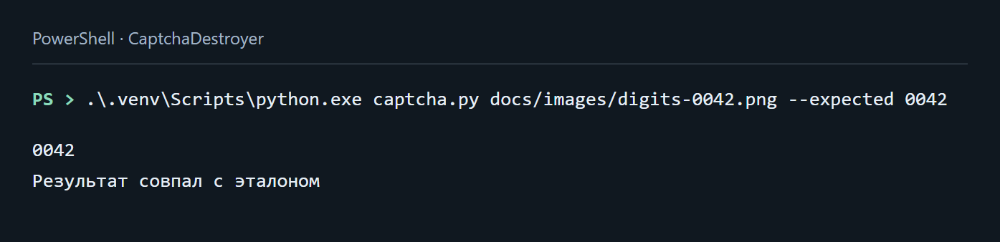

# CaptchaDestroyer · Сканер четырёх цифр

Four-digit OCR for photos and scans. Read an image from the command line or upload it through a REST API. Results preserve leading zeros. Built with Python, Tesseract, and FastAPI.

Распознаёт строку из четырёх цифр на фото или скане. На выходе получается строка `"0042"` с обоими ведущими нулями. Одно изображение можно прочитать из терминала, а из другого приложения — отправить по HTTP.

**[Быстрый старт](#быстрый-старт)** · [Параметры CLI](#параметры-cli) · [Примеры запросов к API](API_README.md#примеры-клиентов) · [Запуск на VPS](API_README.md#развёртывание-на-vps)

| Исходное изображение | Промежуточное изображение OCR | Вывод CLI |
| :---: | :---: | :---: |
|  |  | **`0042`** |

Образец взят из тестов проекта. В средней колонке показан один из вариантов, которые распознаватель передаёт Tesseract. Его можно получить параметром `--debug-dir`.

## Быстрый старт

Понадобятся Python 3.14 и файл модели `eng.traineddata`. Выполняйте команды из корня репозитория. Установка проверена на Windows x64.

1. Скачайте модель и положите её по пути `tessdata/eng.traineddata`. [Модель Tesseract](https://github.com/tesseract-ocr/tessdata_best/blob/4.1.0/eng.traineddata)
2. Создайте виртуальное окружение, установите зависимости и прочитайте изображение из примера выше.

### Windows · PowerShell

```powershell
py -3.14 -m venv .venv
.\.venv\Scripts\python.exe -m pip install -r requirements.txt
.\.venv\Scripts\python.exe captcha.py "docs/images/digits-0042.png" --expected 0042
```

Если команда `py` недоступна, используйте полный путь к `python.exe`. Готовые колёса `tesserocr` для Windows x64 включают движок Tesseract. [Документация tesserocr](https://pypi.org/project/tesserocr/)

### Linux · Bash

```bash
python3.14 -m venv .venv
.venv/bin/python -m pip install -r requirements.txt
.venv/bin/python captcha.py "docs/images/digits-0042.png" --expected 0042
```

При успешной проверке вы увидите `0042` и сообщение о совпадении с эталоном. Чтобы прочитать своё фото, замените путь и уберите `--expected 0042`. Пути с пробелами заключайте в кавычки.

## Параметры CLI

| Параметр | Когда использовать |
| --- | --- |
| `--expected 0042` | Когда известен ответ. Программа распознает изображение и сверит все четыре позиции с эталоном. |
| `--debug-dir ocr-preview` | Чтобы посмотреть промежуточные изображения. Для каждого запуска создаётся отдельная подпапка. |
| `--tessdata ПУТЬ` | Когда файл модели хранится вне каталога `tessdata/` проекта. |

## Как читать результат



| Пример вывода | Значение |
| --- | --- |
| `0042` | Распознаны четыре цифры. |
| `0042 (уверенность низкая, сомнение в третьей цифре)` | Получен предварительный результат. Указанную позицию стоит сверить с оригиналом. |
| `Не удалось распознать CAPTCHA` | Так CLI сообщает об ошибке чтения изображения или отсутствии результата. |

Ответ выводится в `stdout`, диагностика и сообщение о сверке — в `stderr`. Для скриптов код завершения `0` означает успех, `1` — ошибку обработки или отсутствие результата, `2` — расхождение с эталоном или ошибку аргументов.

## Как устроено распознавание

Модуль `captcha.py` подготавливает несколько вариантов изображения и сравнивает ответы Tesseract для всей строки. При низкой уверенности `digit_ocr.py` пытается разделить цифры и сравнивает их форму с результатами OCR.

Для серверного приложения доступен отдельный сервис FastAPI. Он принимает файл по `POST /api/recognize` и возвращает JSON. [Запуск API, примеры клиентов и развёртывание](API_README.md)
